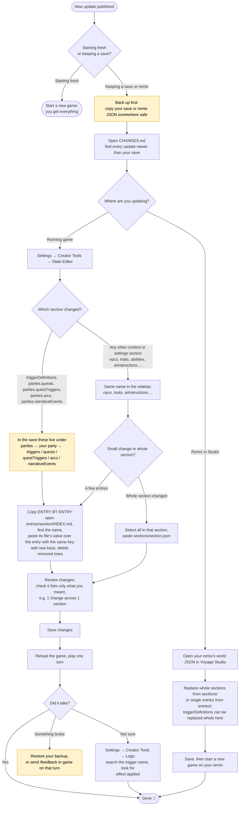

# Updating your save or remix

Tested 2026-11-11 on a real save from before 11.11: the fixed `Clock: Time Line` trigger was copied from
this repository into the save with the in-game State Editor, the save was reloaded, and on the next turn the
game's Logs showed `Clock: Time Line effect applied`. A whole section (`aiInstructions`) was also pasted to check
that the editor accepts and compares it.

## Step by step (running game)

1. **Back up.** Copy your save's JSON before changing anything.
2. **Find what changed.** [`CHANGES.md`](CHANGES.md) lists every update; [`releases/<release>.changes.md`](releases/)
   names each added, modified and removed entry.
3. **Open the editor.** In game: **Settings → Creator Tools → State Editor**. The sidebar lists the save's sections
   with the same names as the files in [`sections/`](sections/).
4. **Triggers, quests and events live inside `parties`.** In a save, the repository's `triggerDefinitions` is
   `parties → (your party) → triggers`, and `parties.quests`, `parties.questTriggers`, `parties.arcs`,
   `parties.narrativeEvents` are `parties → (your party) → quests / questTriggers / arcs / narrativeEvents`.
5. **Copy entries, not the whole `parties` section.** A running save keeps its own state inside its party (which
   events already ran, which loaders already unpacked, your storage values), so pasting a whole trigger list over
   it would reset your game. Replace only the entries the release lists: open `entries/<section>/INDEX.md`, find the
   entry by name, and paste its value over the entry with the same key. Add new keys; delete removed ones.
6. **Other sections can be pasted whole** (for example `aiInstructions`, `npcs`, `traits`): select everything in that
   section and paste `sections/<section>.json`. The editor compares by value, so an identical section shows
   "0 changes".
7. **Review changes**, check that it lists only what you meant (a single trigger showed as
   "1 change across 1 section" with a before/after), then **Save changes**.
8. **Reload and play a turn.** To confirm a trigger works, open **Logs**, search its name, and look for
   "effect applied".
9. **Never copy meta sections** (`compatibilityRevision`, `heroesVersion`) and never paste over `characters`,
   `chatLog` or other save-only sections.

## Notes

- Updates that change many triggers are still easiest on a **new game**: a canon moment whose day already passed
  in your save won't start, even with its trigger copied in.
- If something goes wrong, restore your backup, or send a report with **/feedback** in game on that turn.
